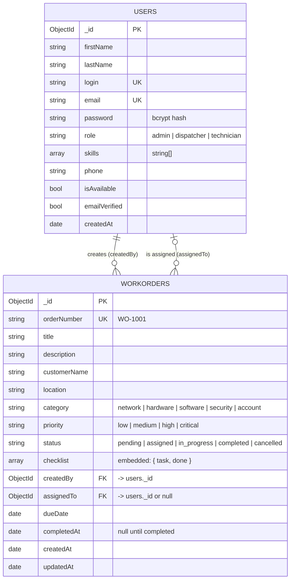

# Database — IT Work Order App

**Database:** MongoDB 7.0 (in Docker) · **Name:** `WorkOrderDB` · **Collections:** `users`, `workorders`

The app is a simple Jira-style work order system for an IT services company: admins and dispatchers create work orders for customer problems, dispatchers assign them to technicians, and technicians work through a checklist until the job is done.

---

## 1. Start the database

From an Ubuntu (WSL) terminal, with Docker Desktop running:

```bash
cd /mnt/c/COP4331/mern-app/backend
docker compose up -d
docker compose logs mongodb | grep "WorkOrderDB seeded"
```

You should see `WorkOrderDB seeded: 8 users, 12 work orders`.

> Port 27017 can only be used by one MongoDB at a time. If the Cards tutorial is running, stop it first: `cd /mnt/c/COP4331/mern-cards/cards-backend && docker compose down`.

| Command (in `backend/`) | What it does |
|---|---|
| `docker compose up -d` | Start MongoDB in the background |
| `docker compose down` | Stop it (data is kept) |
| `docker compose down -v && docker compose up -d` | **Wipe and re-seed** with the test data |
| `docker compose exec mongodb mongosh WorkOrderDB` | Open the Mongo shell |

## 2. Connect with MongoDB Compass

1. Open Compass → **Add new connection**
2. URI: `mongodb://localhost:27017` · Name: `Work Order Database` → **Save & Connect**
3. Expand **WorkOrderDB** → you'll see **users** and **workorders**

---

## 3. Entity Relationship Diagram



(GitHub draws this diagram automatically. For slides, paste it into <https://mermaid.live> and export a PNG.)

**Relationships**
- **One user creates many work orders** (`workorders.createdBy` → `users._id`). Every work order must have one.
- **One technician is assigned many work orders** (`workorders.assignedTo` → `users._id`). It's `null` while a job is `pending` (not yet assigned).

---

## 4. Collections and fields

### `users` (8 test documents)

| Field | Type | Notes |
|---|---|---|
| `_id` | ObjectId | Primary key, created by MongoDB |
| `firstName`, `lastName` | String | |
| `login` | String | **Unique**; username for signing in |
| `email` | String | **Unique**; used for email verification |
| `password` | String | **bcrypt hash** — never plain text |
| `role` | String | `admin`, `dispatcher`, or `technician` — controls what each person can do |
| `skills` | Array of String | Categories a technician can handle; empty `[]` for admins/dispatchers |
| `phone` | String | |
| `isAvailable` | Boolean | Dispatcher checks this before assigning a job |
| `emailVerified` | Boolean | `false` until the user clicks the verification link |
| `createdAt` | Date | When the account was made |

### `workorders` (12 test documents)

| Field | Type | Notes |
|---|---|---|
| `_id` | ObjectId | Primary key |
| `orderNumber` | String | **Unique**, human-friendly id like `WO-1001` |
| `title`, `description` | String | What's wrong |
| `customerName`, `location` | String | Who called and where the job is |
| `category` | String | `network`, `hardware`, `software`, `security`, `account` — matched against technician `skills` |
| `priority` | String | `low`, `medium`, `high`, `critical` |
| `status` | String | `pending` → `assigned` → `in_progress` → `completed` (or `cancelled`) |
| `checklist` | Array of `{ task, done }` | **Embedded** steps the technician ticks off |
| `createdBy` | ObjectId | **Foreign key → `users._id`** (who opened the order) |
| `assignedTo` | ObjectId or null | **Foreign key → `users._id`** (the technician); `null` while pending |
| `dueDate` | Date | |
| `completedAt` | Date or null | Set when the job is completed |
| `createdAt`, `updatedAt` | Date | Maintained automatically by Mongoose |

---

## 5. Test accounts

All passwords: **`Password123!`**

| Login | Name | Role | Skills | Available |
|---|---|---|---|---|
| `amoreno` | Alicia Moreno | admin | — | yes |
| `dchen` | Derek Chen | dispatcher | — | yes |
| `pnatarajan` | Priya Natarajan | dispatcher | — | yes |
| `mjohnson` | Marcus Johnson | technician | network, hardware | no |
| `sramirez` | Sofia Ramirez | technician | software, account | yes |
| `kokafor` | Kevin Okafor | technician | security, network | yes |
| `hlee` | Hannah Lee | technician | hardware, software | no |
| `tbrooks` | Tyler Brooks | technician | network, security, hardware | yes (email not verified) |

Work orders cover every status: 2 pending, 3 assigned, 3 in progress, 3 completed, 1 cancelled.

---

## 6. Design decisions (what to explain to the GTA)

1. **Two collections, linked by id.** Users and work orders are separate because each is used on its own (a user list, a job queue) and both grow independently. A work order stores the user's `_id`, like a foreign key in SQL.
2. **Two references to the same collection.** `createdBy` and `assignedTo` both point at `users`. This keeps one list of people with a `role` field, instead of separate admin/dispatcher/technician collections.
3. **Checklist is embedded, not its own collection.** Checklist items only make sense inside their work order, are always loaded with it, and are small. Embedding means one read gets the whole job — the MongoDB rule of thumb: *embed what you read together, reference what stands alone.*
4. **Every document has the same fields.** Optional values are stored as `null` or `[]` (e.g. `assignedTo: null`, `skills: []`) rather than leaving the field out, so documents in a collection are consistent.
5. **The database enforces the structure.** Each collection has a **`$jsonSchema` validator** (Compass → *Validation* tab): required fields, types, and allowed values. Inserting a document that breaks the rules is rejected. Mongoose models in `backend/models/` apply the same rules in the API.
6. **Indexes** (Compass → *Indexes* tab): unique on `users.login`, `users.email`, `workorders.orderNumber` to prevent duplicates; compound indexes on `{assignedTo, status}` (a technician's open jobs) and `{status, priority}` (the dispatcher queue).
7. **Security.** Passwords are bcrypt hashes. The database port is bound to `127.0.0.1`, so only this computer can connect.
8. **Room to grow.** Later versions can add an AI-suggestion field on work orders, photo/notes collections for technicians, or a `customers` collection, without changing what's here.

## 7. Likely questions

- **"Where's the foreign key?"** `workorders.createdBy` and `workorders.assignedTo` hold a `users._id`. Show a work order, copy its `assignedTo`, then filter users with `{ _id: ObjectId("...") }`.
- **"Does MongoDB enforce the relationship?"** Not by itself — there are no real foreign key constraints. Our API checks that the user exists (and is a technician) before saving. The validator makes sure the field is an ObjectId.
- **"Why not put work orders inside the user?"** A user can have unlimited work orders (documents max out at 16 MB), and work orders are queried on their own, by status and priority.
- **"Why ObjectId instead of a string for the reference?"** It matches `_id`'s type exactly, takes less space, and works with Mongoose's `populate()` and `$lookup` joins.
- **"Why is `assignedTo` null on some orders?"** They're `pending`: created but not yet assigned by a dispatcher.

## 8. Handy Compass filters for the demo

Paste into the **Filter** bar of the collection:

| Collection | Filter | Shows |
|---|---|---|
| workorders | `{ status: "pending" }` | Unassigned jobs (`assignedTo: null`) |
| workorders | `{ priority: "critical" }` | The security incident |
| workorders | `{ status: { $in: ["assigned", "in_progress"] } }` | Open jobs |
| users | `{ role: "technician", isAvailable: true }` | Who a dispatcher could assign |
| users | `{ skills: "network" }` | Technicians who can do network jobs |

**Join demo** (workorders → **Aggregations** tab, add a `$lookup` stage):

```json
{ "from": "users", "localField": "assignedTo", "foreignField": "_id", "as": "technician" }
```

Each work order now shows its full technician document — proof the reference works.

## 9. Lab demo script (about 3 minutes)

1. Compass connected → expand **WorkOrderDB** → show **users** and **workorders** (rubric: connect + collections)
2. Open **users**: point out consistent fields, the bcrypt `password`, `role`, `skills`
3. Open **workorders**: point out the fields, the embedded `checklist`, and **`createdBy` / `assignedTo` → users._id** (rubric: document properties + foreign key)
4. Copy an `assignedTo` id → go to users → filter `{ _id: ObjectId("<id>") }` → that technician appears
5. Optional extras: **Validation** tab (schema rules), **Indexes** tab, the `$lookup` aggregation
